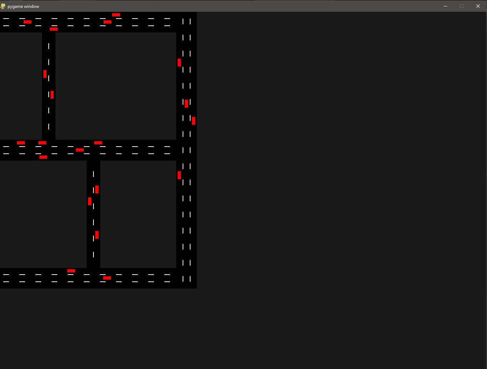

# Traffic Simulator

Hey! this is the overview of my cool-ish project centered around **Traffic** :)

first off heres a snapshot



The simulation is based on real world factors that affect the movement of traffic on roads. Aimed at testing different road networks the project allows user to test how a intersection or a traffic sign might affect the overall flow of traffic on the roads.

## Overview
Main idea behind the project is to simulate traffic on a custom road network as real as possible

this will be achieved at many different levels, ranging from the physics of acceleration to reaction time of the driver

The project is made to simulate traffic under different road conditions.The bound of the program will include:
1. road networks
2. Vehicles with variable driving style:
    1. Acceleration
    2. Response time
3. Traffic lights & intersections
4. Pathfinding
5. Randomized destinations

## Key Feature:
1. Adaptive Speeds: Each car will calculate the bumper to bumper gap from the car ahead and based on that and the speed of the car ahead will accelerate, brake or maintain its own speed
2. Driver Inputs: To achieve a simualtion as close to the real world there are 3 types of drivers
    - Aggressive
    - Calm
    - Nervous

    The car`s movement in any case depends highly on the driver driving it, for example a nervous driver accelerates less but brakes more, using some contants this is implemented
3. Pathfinding: The project uses Dijkstra to find the shortest route for the 2 destinations, under future updates it will allow the driver to chose between shortest or fastest route
4. Real-life Limitations: Each car has a randomized realsitic value for its maximum acceleration, maximum speed and maximum braking to avoid any supernatural values


## Understanding the initialization

Right now the UI for making the road network is not ready therefore it is recommeded to use the roadnetwork already provided but if you wish you make your custom network, edit the file **ObjectCreations.py**

This file controls all the objects in the simualtions

The roads are made such that there are no overlapping,

*for calculation purposes the lanes are 3.6m, you will need it if you wish to make a new network*

If the nodes on the roads are changed then a dictionary graph needs to be altered, it should be such that when standing at the current node(key of the dictionary) where can we go and which road do we need to take.


## Technologies Used

- Python: backend of the project such as calculations
- Pygame: Frontend of the project

## How to Run Locally

To run this project on your local machine, do the following

1. Clone the repositry:

    ```
    git clone https://github.com/rapheal20/Traffic-Simulator
    cd Traffic-Simulator
    ```

2. Create and activate a virtual environment (Recommended):

    ```
    python -m venv venv
    # On Windows:
    venv\Scripts\activate
    # On macOS/Linux:
    source venv/bin/activate
    ```

3. Install the required dependencies:
    ```
    pip install -r requirements.txt
    ```

4. Run the Pygame application:
    ```
    python Visualize.py
    ```
    *The application should be running in a new window*


## AI DISCLOSURE
- Research purposes including initial planning of the project
- Generating custom formulas related to the physics
- No direct copy pasting without understanding
- small snippets of code of completely new concepts
- Debugging errors

# Future Plans

The project is divided into several phases, the rough breakdown is as follows

- Phase 1: Make the basics functional, the UI working and make each car independent
- Phase 2: Add traffic signals and adaptive lane changing
- Phase 3: Collisions and their after effects
- Phase 4: Statistical data and adpative routing
- Phase 5: A UI for making the road network

As of right now only phase 1 is complete with little progress done on the other phases

I am shipping this project for now but will continue to work on it. Overall the development process was a great experience desipte it getting complicated at time due to the nature of it but definately enjoyed it

This Project is made as part of Phantom even in Hack Club.
